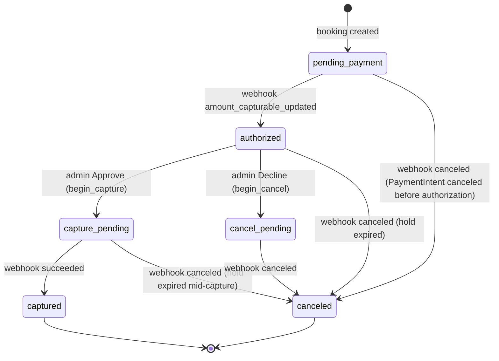

# GigHold

## What it is

<!-- PROSE: what it is (Blake) -->

## Live demo and stack

**Live demo:** https://gighold.vercel.app

It runs against a Stripe sandbox only. No real money moves, and only [Stripe test cards](https://docs.stripe.com/testing) work.

| Piece | Version |
|---|---|
| Node.js | 24 |
| Next.js (App Router, `proxy.ts`) | 16.4.6 |
| React, React DOM | 19.3.0 |
| TypeScript | 5.9.3 installed (`^5`) |
| Stripe Node SDK (`stripe`) | 23.2.0 |
| Supabase client (`@supabase/supabase-js`) | 2.119.2 |
| `server-only` | 0.0.1 |
| Tailwind CSS, `@tailwindcss/turbopack` | 4.3.3 |
| Vitest | 5.1.1 installed (`^5.1.1`) |
| `pg` (database tests only) | 8.23.1 installed (`^8.23.1`) |
| `dotenv` (tests only) | 18.0.10 installed (`^18.0.10`) |

The database is Supabase Postgres. The app is hosted on Vercel.

## Booking states



There are six statuses: `pending_payment`, `authorized`, `capture_pending`, `captured`, `cancel_pending` and `canceled`. Any other transition raises an error in the database trigger (`bookings_guard`).

## How this can't charge twice

Six layers, each independent of the others.

1. **Compare-and-set in the database.** `begin_capture` (`supabase/migrations/0001_init.sql`) moves a booking from `authorized` to `capture_pending` only if it is still `authorized`, and returns the PaymentIntent id only to the caller that made the move. A second click or a second tab gets `NULL`, and `app/admin/actions.ts` then makes no Stripe call. Proven by test D3 and manual check E3.
2. **Stripe idempotency key.** The capture call carries the key `capture:<booking id>`, built by `idempotencyKey` in `lib/bookingStatus.ts`, so a retried request gets the first response back instead of capturing again. Test U2 checks that the key is deterministic and differs from the cancel key.
3. **Event dedupe in the same transaction as the status change.** `apply_stripe_event` records each Stripe event id in `stripe_events` and returns `duplicate` for a second delivery before it touches the booking. Proven by test D4 and by replaying an event locally (E2) and live (L2).
4. **The trigger.** `bookings_guard` rejects any status change outside the eight arrows above, and any change to `amount_cents`, even from the table owner in a manual SQL session. Tests D1 and D2.
5. **Stripe itself.** A PaymentIntent can be captured only "when its status is `requires_capture`"; otherwise Stripe "returns an error if the PaymentIntent isn't capturable". Source: https://docs.stripe.com/api/payment_intents/capture
6. **`payment_intent_id` is unique.** A unique constraint on `bookings.payment_intent_id` (migration 0001) means one PaymentIntent can never be attached to two bookings.

## Where the deposit amount lives

The deposit lives in the database, not in app code.

- `bookings.amount_cents` has `DEFAULT 15000` ($150.00, in cents).
- Migration `0002_amount_default.sql` revokes `service_role`'s column-level INSERT on `amount_cents`, so the app's database role cannot supply an amount at all.
- `createBooking` (`app/actions.ts`) inserts three columns (`customer_name`, `customer_email`, `event_date`) and reads `amount_cents` and `currency` back with `RETURNING`. Those two values become the `unit_amount` and `currency` of the Stripe Checkout Session.
- Test D7b proves that an INSERT naming `amount_cents` is denied for `service_role`, and that an INSERT without it gets 15000 from the default.

This replaces the "server-side constant" in SPEC §3, so the database, not app code, owns the price. Nothing from the browser is ever read as an amount.

## Security

- **Revoke, then grant.** The migration first revokes everything on both tables from `anon`, `authenticated` and `service_role`, and EXECUTE on every function from those three roles and from `PUBLIC`. It then grants `service_role` only what the app needs.
- **Row level security is on, with no policies.** Nothing reads the database from the browser, so no role other than the server's needs to see a row.
- **`service_role` has no UPDATE or DELETE on `bookings`** (test D7). A status changes only through `begin_capture`, `begin_cancel` and `apply_stripe_event`.
- **Secret keys are server-only.** `lib/stripe.ts` and `lib/supabase.ts` import `server-only`, so importing either from a Client Component fails the build. The Supabase key is the secret key (`sb_secret_…`), not the legacy `service_role` JWT.
- **The webhook signature is verified on the raw body.** `app/api/stripe/webhook/route.ts` reads `request.text()` and passes it to Stripe's `constructEvent` before anything parses it. A bad or missing signature gets a 400 and no database call (test U3).
- **Admin access is HTTP Basic Auth, checked three times** by one function, `isAdminAuthorized` in `lib/adminAuth.ts`: in `proxy.ts`, at the top of the `/admin` page, and inside every admin Server Action. It fails closed (if `ADMIN_USER` or `ADMIN_PASSWORD` is unset or empty, every request is denied) and compares in constant time (`timingSafeEqual` on SHA-256 digests).
- The `/admin` page answers 404 (`notFound`) rather than 401 when its own check fails. The 401 and the browser's login prompt are the proxy's job; the page's only job is to show no data.
- Card details never reach the app. Payment happens on Stripe-hosted Checkout.

## Running it locally

You need Node 24, a Stripe sandbox, a Supabase project and the Stripe CLI.

1. Install the packages:

   ```
   npm install
   ```

2. Copy `.env.example` to `.env.local` and fill in every value. `.env.local` is gitignored.

   | Name | What it is |
   |---|---|
   | `STRIPE_SECRET_KEY` | the sandbox secret key (starts `sk_test_`) |
   | `STRIPE_WEBHOOK_SECRET` | the signing secret (starts `whsec_`) from `stripe listen` |
   | `SUPABASE_URL` | the project URL |
   | `SUPABASE_SECRET_KEY` | the secret key (starts `sb_secret_`) |
   | `DATABASE_URL` | the session pooler connection string. **Tests only**; the app never reads it |
   | `ADMIN_USER` | your choice |
   | `ADMIN_PASSWORD` | your choice |
   | `SITE_URL` | `http://localhost:3000` |

3. Apply the migrations (see below).

4. Start the app:

   ```
   npm run dev
   ```

5. In a second terminal, forward Stripe's webhooks to it:

   ```
   stripe listen --forward-to localhost:3000/api/stripe/webhook --events payment_intent.amount_capturable_updated,payment_intent.succeeded,payment_intent.canceled
   ```

   Careful: the banner `stripe listen` prints includes the signing secret. Don't paste that output into a chat, an issue or a screenshot.

**Migrations.** The files in `supabase/migrations/` are applied by hand, in number order, in the Supabase SQL Editor. Each one is first dry-run inside `BEGIN; … ROLLBACK;`, then run for real. A file is never edited after it has been applied; a fix goes in the next numbered file.

## Tests

```
npm test
```

This runs the unit tests and the database tests: 3 files, 14 tests. For the database tests, `DATABASE_URL` must be the Supabase **session pooler** string. Each database test runs inside `BEGIN … ROLLBACK` and closes its connection, so nothing persists.

**Unit tests** (`tests/unit.test.ts`; no network, no database):

- **U1:** `canTransition` is true for exactly the 8 allowed transitions and false for the other 28 pairs.
- **U2:** idempotency keys are deterministic, and the capture key differs from the cancel key.
- **U3:** the webhook route returns 400 for an invalid or missing signature and makes no database call. A control case sends a correctly signed body and expects the database stand-in to be called, which proves the "no database call" assertion can fail.

**Database tests** (`tests/db.d1-d7.test.ts`):

- **D1:** the trigger rejects `pending_payment → captured`.
- **D2:** the trigger rejects a change to `amount_cents`.
- **D3:** `begin_capture` returns the PaymentIntent id once, then `NULL`; the status is `capture_pending`.
- **D4:** the same event id twice returns `processed`, then `duplicate`; `delivery_count` is 2; the status changed once.
- **D5:** an out-of-order event (`succeeded` while `authorized`) is `ignored`, and the status is unchanged.
- **D6:** role `anon` cannot SELECT from `bookings`.
- **D7:** role `service_role` cannot UPDATE or DELETE rows in `bookings`.
- **D7b:** role `service_role` cannot INSERT `amount_cents`; without it, the default sets 15000.

`tests/db.smoke.test.ts` holds one more test: it connects and checks that both tables exist.

**Manual checks.** All passed.

- E1–E5, local, with the Stripe CLI forwarding webhooks: passed 2026-11-25. Happy path, replayed event, double approve in two tabs, decline, and a declined card.
- L1–L3, live on Vercel: passed 2026-11-26. Happy path, replayed event, and decline.

## Known limitations

- An abandoned Checkout leaves the booking `pending_payment` forever. Stripe creates no PaymentIntent until the card is submitted, so there is no event to react to.
- A failed capture leaves the booking `capture_pending`; a failed decline leaves it `cancel_pending`. There is no retry button.
- If the Stripe call fails after the booking insert, the booking stays `pending_payment`, because app code cannot delete. If the insert commits but its response is lost, the log shows `bookingId` null though a row exists.
- If `begin_capture` commits but its response is lost, the admin sees "Nothing was sent to Stripe" (true), but the booking is already `capture_pending` with no capture coming.
- If Stripe captures but its response is lost, the admin sees a failure notice; the `payment_intent.succeeded` webhook still moves the booking to `captured`. The notice is a snapshot; the webhook is the truth.
- A double-click on "Continue to payment" can create two bookings and two Checkout Sessions.
- No rate limiting.
- Link is turned off in the Stripe sandbox, because Link holds don't expose `capture_before`. Other wallets still appear at Checkout and would give an authorized booking with no hold-expiry date (logged as `captureBeforeMissing`). The demo and the tests use the card form.
- One shared environment: local and production use the same Stripe sandbox and the same Supabase project, so local bookings' events also reach the production webhook (deduped, harmless).
- Reconciliation against Stripe, hold-expiry alerts and abandoned-checkout cleanup are not built.

## Deviations from SPEC.md v1.2

`SPEC.md` is frozen, so the places where the shipped app differs from it are recorded here.

- **The deposit amount is in the database,** not a server-side constant. See "Where the deposit amount lives".
- **`vitest.config.mts` instead of `vitest.config.ts`.** The `.mts` extension clears a Vite ESM warning.
- **Link is turned off** in the Stripe sandbox. See "Known limitations".
- **An extra admin notice code, `db-error`,** for failures that happen before the Stripe call.
- **The `/admin` page refuses with 404,** not 401. See "Security".
- **INSERT on `bookings` is granted per column,** not on the whole table as SPEC §8 says: three columns after migration 0002. An insert that names `status`, `amount_cents` or any other column is refused.
- **EXECUTE on the trigger function `bookings_guard()` is revoked** from every role, beyond the three functions SPEC §8 lists.
- **`apply_stripe_event` will not authorize a booking without a PaymentIntent id.** The update has an extra `p_payment_intent_id is not null` guard that the SPEC §7 table does not have.
- **Two tests beyond SPEC §11's list:** D7b and the connection smoke test.
- **Tailwind is wired through `@tailwindcss/turbopack`,** as installed by `create-next-app` 16.4.6, rather than the PostCSS plugin SPEC §13 names. Accepted as scaffold-installed.

## How it was built

<!-- PROSE: how it was built (Blake) -->
