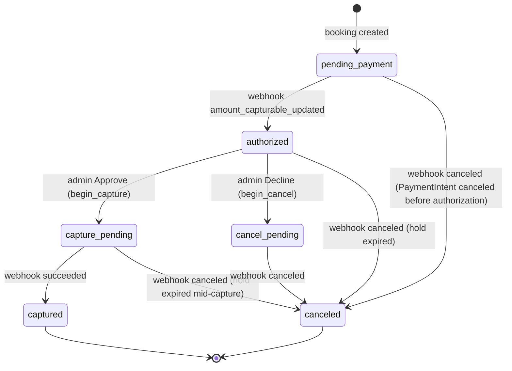

# GigHold — Spec v1.2

*Status: **v1.2 APPROVED by Blake 2026-11-18.** Frozen for the build. Changes from here go to `PARKING_LOT.md` and are not built. The change log is at the end.*

*Claim labels: **Sourced** (link in §15) · **From memory** (must be checked against the official docs during the build) · **Decision** (a choice made in this spec)*

## 0. Decisions recorded at approval

| # | Decision |
|---|---|
| 1 | Domain: a gig-booking deposit app |
| 2 | Node.js 24 LTS |
| 3 | The GitHub repo is public from the first commit |
| 4 | **BWAI Labs branding** (added at approval; see §3a) |
| 5 | **Scaffold choices** (v1.2): Next.js pinned to major 16; **Cache Components off**; React Compiler off; `AGENTS.md` on; agent feedback off. Reason: `create-next-app` now turns Cache Components on by default (*Sourced*), which adds a second rendering model to learn on a clock. The classic App Router model is enough for this app. |

---

## 1. Purpose

GigHold is a deliberately small, deployed demo that proves five things in an interview:

1. **Authorize-then-capture with Stripe.** The card is put on hold at booking and charged only when an admin approves.
2. **Webhooks that cannot double-process.** A replayed event changes nothing, and you can show that live.
3. **A database-enforced state machine.** The database is the referee. App code cannot move a booking into an illegal state.
4. **Tests.** Unit tests plus database tests. The database tests run in rolled-back transactions.
5. **Agent-built under a written plan.** Built with Claude Code from this spec, with each step verified by a human.

It ships as a **BWAI Labs** app, so it also shows Blake Wagner AI's own product look.

The domain is gig booking. A customer asks a band to play an event and puts a $150 deposit on hold. The band approves (capture) or declines (release). This follows the same authorize → review → capture pattern as a self-serve sponsorship platform, without copying one. *Decision.*

---

## 2. User stories

- **Customer:** "I request a date and put a deposit on hold. I'm told plainly that I haven't been charged."
- **Admin:** "I see every booking and its status. Approving charges the hold exactly once. Declining releases it."
- **System:** "If no one acts, Stripe releases the hold when the authorization expires, and the booking becomes `canceled`."

  For online customer-initiated card payments the window is typically 7 days. For Visa merchant-initiated payments it is 5. *Sourced.*

**Known gap:** a customer who abandons Checkout before submitting a card leaves a `pending_payment` booking that never changes. Stripe creates the PaymentIntent only when the customer submits payment, so there is no PaymentIntent and no event to react to. *Sourced.* Cleanup is out of scope (§4) and is listed in the README as a known limitation.

---

## 3. In scope (exhaustive)

| Route / file | Type | Access | Purpose |
|---|---|---|---|
| `/` | Page + Server Action | Public | Form (name, email, event date). Creates a booking, creates a Stripe Checkout Session, redirects to Stripe. |
| `/thanks` | Page | Public | "Your card is on hold. You have not been charged." |
| `/admin` | Page + Server Actions | Basic Auth | Bookings table with Approve / Decline buttons, plus the last 20 webhook events. |
| `/api/stripe/webhook` | Route Handler | Stripe only (signature) | Verifies the signature, extracts the fields, calls `apply_stripe_event`. |
| `proxy.ts` | Next.js 16 proxy | — | Basic Auth gate on `/admin`. |

**The deposit is fixed at 15000 cents (USD).** It is a server-side constant and is never read from the client. *Decision.*

**`/admin` is rendered on every request, never prerendered at build time.** Its auth re-check (§8) reads the request headers, which also makes Next.js treat the page as dynamic. *From memory: confirm in the `npm run build` route list at M5.*

---

## 3a. Branding

**Claude Code invokes the `bwai-brand` skill (kit 1.1.0) and follows it.** *Decision.* The skill owns the how:
- copying the kit files into the project
- fonts, tokens and contrast
- the top bar, page header and footer
- its own pre-handover checklist

This spec records only the choices the skill asks us to make:

| The skill asks for | Our answer |
|---|---|
| Product line | **BWAI Labs** (an app) |
| Surface and intensity | App, built with the kit's HTML "apps and tools" pattern; dark |
| Tailwind | The skill says to confirm the major version first. If it's v4 (likely; *From memory*), use the kit's CSS classes, with Tailwind for layout only |
| App name and top-bar links | "GigHold"; links Book (`/`) and Admin (`/admin`) |

**Per page:**

| Page | Title | Highlight card (max one) | Content |
|---|---|---|---|
| `/` | Book the band | "$150 deposit · held, not charged until we confirm" | The form inside a card |
| `/thanks` | You're on hold | "Hold placed · $150.00 · You have not been charged" | One short card saying what happens next |
| `/admin` | Bookings | none | Bookings and events in flat tables; each status shown with its word |

**If the skill lacks a token or component, Claude Code stops and tells Blake** (the skill's own rule).

---

## 4. Out of scope (explicit; will not be built)

- User accounts or Supabase Auth
- Email of any kind
- HubSpot, AI-assisted copy, and multiple bands, markets or prices
- Refunds and partial captures
- Automated jobs for expiring holds; checkout-expiry handling beyond the state rule in §5
- Cleanup of abandoned `pending_payment` bookings (§2, known gap)
- Retry button for a failed capture. If a capture fails, the booking stays in `capture_pending`; this is listed in the README as a known limitation.
- Live (real-money) Stripe mode and a custom domain
- Brand work beyond §3a: the light theme, new tokens or components, an Open Graph image, motion or animation
- Cache Components, the React Compiler, and Next.js agent skills or MCP setup (§0, decision 5)
- CI/GitHub Actions, the Supabase CLI, local Docker, generated database types, rate limiting
- Separate dev and prod environments. One Stripe sandbox and one Supabase project are shared by local and Vercel. This is a deliberate demo shortcut and is documented as such.

---

## 5. Booking state machine

**Statuses (exactly six):** `pending_payment`, `authorized`, `capture_pending`, `captured`, `cancel_pending`, `canceled`.

**Allowed transitions (exactly eight):** the arrows in the diagram above. Any other status change raises an exception in the database.

**Note on `pending_payment → canceled`:** this arrow is a guard, and it rarely fires. It covers a PaymentIntent that exists and is later canceled. An abandoned Checkout has no PaymentIntent at all (§2), so that case never reaches it.

---

## 6. Data model

### `public.bookings`

| Column | Type | Rules |
|---|---|---|
| `id` | uuid | PK, default `gen_random_uuid()` |
| `customer_name` | text | not null; length 1–100 (enforced in the app) |
| `customer_email` | text | not null |
| `event_date` | date | not null; must be today or later (enforced in the app) |
| `amount_cents` | integer | not null, `> 0`, **immutable after insert** (trigger) |
| `currency` | text | not null, default `'usd'` |
| `status` | text | not null, default `'pending_payment'`, CHECK in the six statuses |
| `payment_intent_id` | text | unique, null until authorized |
| `capture_before` | timestamptz | null until authorized; from Stripe |
| `created_at` | timestamptz | not null, default `now()` |
| `updated_at` | timestamptz | not null, default `now()`, set by trigger |

**Trigger** `bookings_guard`, BEFORE UPDATE:

- Rejects any status change that is not one of the eight allowed transitions.
- Rejects any change to `amount_cents`.
- Sets `updated_at`.

The trigger function sets `search_path = ''` and schema-qualifies its objects, the same as the functions in §7.

### `public.stripe_events`

| Column | Type | Rules |
|---|---|---|
| `id` | text | PK (Stripe `evt_…` id) |
| `type` | text | not null |
| `booking_id` | uuid | null. **No foreign key, deliberately.** An event can reference a booking that doesn't exist (a fixture event or another environment), and a webhook must never return 500 for that. |
| `outcome` | text | CHECK in (`processed`, `ignored`); null only within the same transaction, before the outcome is set |
| `delivery_count` | integer | not null, default 1 |
| `first_received_at` | timestamptz | not null, default `now()` |
| `last_received_at` | timestamptz | not null, default `now()` |

### Migrations

Schema lives in numbered files under `supabase/migrations/`. Once a file has been applied to the database it is never edited. A fix goes in the next numbered file. *Decision.*

---

## 7. Database functions (the contract)

All three functions are `SECURITY DEFINER` with `SET search_path = ''`, and every object inside them is schema-qualified.

### `public.begin_capture(p_booking_id uuid) returns text`

- Compare-and-set: `authorized → capture_pending` **only if** the current status is `authorized`.
- Returns the booking's `payment_intent_id` if the transition happened, `NULL` otherwise.

### `public.begin_cancel(p_booking_id uuid) returns text`

- Same pattern: `authorized → cancel_pending`.
- Returns the `payment_intent_id` or `NULL`.

### `public.apply_stripe_event(p_event_id text, p_event_type text, p_booking_id uuid, p_payment_intent_id text, p_capture_before timestamptz) returns text`

Runs entirely inside the function's single transaction:

1. Upsert into `stripe_events`. On conflict, increment `delivery_count` and set `last_received_at`. **If `delivery_count > 1`, return `'duplicate'` and change nothing else.**
2. Apply the mapping below with a guarded `UPDATE … WHERE status IN (allowed from-states)`.
3. If the update touched 0 rows, or the type is unmapped, or `p_booking_id` is null, set the outcome to `'ignored'`. Otherwise set it to `'processed'`. Return the outcome.
4. If anything raises an error, the whole function rolls back, including the event insert. The route returns 500 and Stripe retries.

| Event type | Allowed from | To | Also sets / checks |
|---|---|---|---|
| `payment_intent.amount_capturable_updated` | `pending_payment` | `authorized` | sets `payment_intent_id`, `capture_before` |
| `payment_intent.succeeded` | `capture_pending` | `captured` | row's `payment_intent_id` must equal `p_payment_intent_id` |
| `payment_intent.canceled` | `pending_payment`, `authorized`, `capture_pending`, `cancel_pending` | `canceled` | `payment_intent_id` is null **or** equals `p_payment_intent_id` |
| anything else | — | — | outcome `ignored` |

---

## 8. Security and grants

- **Explicit grants.** New Supabase projects have not exposed new `public` tables and functions to the Data API automatically since 2026-05-30; the same rule reached existing projects on 2026-10-30. *Sourced.* The migration therefore includes every grant explicitly. If the project-creation screen shows an "automatically expose new tables" option, leave it **off**.
- **RLS** is enabled on both tables, with **no policies**. Anyone who isn't bypassing RLS sees nothing.
- **Revoke first, then grant.** `REVOKE ALL` on both tables from `anon`, `authenticated` **and `service_role`**. `REVOKE EXECUTE` on all three functions from `PUBLIC`, `anon`, `authenticated` and `service_role`. (Postgres grants EXECUTE to PUBLIC by default. *From memory.*) Revoking first makes the result the same whichever default the project started with.
- **Then `service_role`** gets `SELECT, INSERT` on `bookings`, `SELECT` on `stripe_events`, and `EXECUTE` on the three functions. Nothing else.
- **No UPDATE or DELETE grants anywhere.** The only way to change a status is through the three audited functions. Test D7 proves it.
- **The app server uses the Supabase secret key (`sb_secret_…`).** It maps to `service_role` and bypasses RLS, so it is server-only: it lives in modules that import `server-only`. The legacy `service_role` JWT is not used, because Supabase deprecates the legacy keys at the end of 2026. *Sourced.*
- **Webhook signatures** are verified against the raw request body. An invalid signature gets a 400.
- **Admin access** is HTTP Basic Auth checked in three places with one shared function: in `proxy.ts`, at the top of the `/admin` page (it shows customer names and emails), and inside every admin Server Action. The proxy is the front door, not the only lock. *Decision.*
- **Admin auth fails closed.** If `ADMIN_USER` or `ADMIN_PASSWORD` is unset or empty, every request is denied. Credentials are compared in constant time (Node `crypto.timingSafeEqual` on fixed-length digests). `proxy.ts` runs on the Node.js runtime, so Node's `crypto` is available there. *Sourced.*
- **Card data never touches the app.** Payment happens on Stripe-hosted Checkout.
- **Secrets** live only in `.env.local` (gitignored) and Vercel environment variables. They never appear in code, tests, logs, commits, Claude Code prompts or chat.

---

## 9. Stripe integration contract

### Checkout Session

- `mode: payment`, with one line item: "Booking deposit", $150.00.
- `payment_intent_data.capture_method: 'manual'`. *Sourced.*
- `payment_intent_data.metadata.booking_id: <uuid>`. *From memory: confirm this lands on the PaymentIntent.*
- `success_url: ${SITE_URL}/thanks`, `cancel_url: ${SITE_URL}/`.

### Webhook

- **Events handled (only these three):** `payment_intent.amount_capturable_updated` (fires when a manual-capture PaymentIntent has funds on hold; *Sourced*), `payment_intent.succeeded`, `payment_intent.canceled`.
- **On `amount_capturable_updated`:** retrieve the PaymentIntent's latest charge and read `payment_method_details.card.capture_before`. *Sourced.*
- **`booking_id`** comes from the PaymentIntent metadata. If it is missing or not a valid UUID, pass `NULL`, and the event is recorded as `ignored`.
- **Responses:** 400 for a bad signature; 200 for `processed`, `duplicate` or `ignored`; 500 for a database error, so that Stripe retries.

### Admin actions

- **Approve:** `begin_capture(id)` → if it returns a PaymentIntent id, call `paymentIntents.capture(pi, {}, { idempotencyKey: 'capture:' + bookingId })`.
- **Decline:** `begin_cancel(id)` → if it returns a PaymentIntent id, call `paymentIntents.cancel(pi, {}, { idempotencyKey: 'cancel:' + bookingId })`. A PaymentIntent that belongs to a Checkout Session can be canceled directly only while it is `requires_capture`, which is exactly our `authorized` state. *Sourced.*
- **Final status** (`captured` or `canceled`) is set only by the webhook, never by the action.

---

## 10. "Can't charge twice": the layers

1. **Compare-and-set in the database.** `begin_capture` succeeds for only one caller. A double-click or a second tab gets `NULL`.
2. **Stripe idempotency key** on the capture call. A retried request returns the first result instead of capturing again.
3. **Event dedupe in the same transaction as the state change.** A replayed webhook returns `'duplicate'` before touching the booking.
4. **The trigger** rejects illegal transitions, even from a buggy code path or a manual SQL session.
5. **Stripe itself** refuses to capture a PaymentIntent that is no longer in `requires_capture`. This is the final backstop. *From memory: confirm in the docs.*
6. **`payment_intent_id` is unique,** so there is one PaymentIntent per booking.

---

## 11. Tests (exhaustive list)

**Unit tests** (Vitest, no network):

- **U1:** `canTransition(from, to)` is true for exactly the 8 allowed pairs and false for a sample of illegal ones. This is UI-only and decides which buttons appear.
- **U2:** idempotency keys are deterministic, and the capture key differs from the cancel key.
- **U3:** the webhook route returns 400 for an invalid signature and makes no database call.

Test setup stubs the `server-only` package, which throws when imported outside a React Server environment. *From memory.* The `@/` alias is set with `resolve.alias` in `vitest.config.ts`; no Vitest plugins are added (§13).

**Database tests** (Vitest + `pg` over the Supabase session pooler). Each test runs in `BEGIN … ROLLBACK`, so nothing persists. Every client is closed when its test ends.

- **D1:** the trigger rejects `pending_payment → captured`.
- **D2:** the trigger rejects a change to `amount_cents`.
- **D3:** `begin_capture`: the first call returns the PaymentIntent id and the second returns `NULL`; the status is `capture_pending`.
- **D4:** `apply_stripe_event` with the same event id twice returns `processed` then `duplicate`; `delivery_count = 2`; the status changed once.
- **D5:** an out-of-order event (`succeeded` while the booking is `authorized`) is `ignored`, and the status is unchanged.
- **D6:** role `anon` cannot `SELECT` from `bookings` (permission denied).
- **D7** (v1.2): role `service_role` cannot `UPDATE` or `DELETE` rows in `bookings` (permission denied). This is the test behind "app code cannot change a status directly."

**Manual end-to-end, local** (Stripe CLI forwarding):

- **E1 Happy path:** card 4242 → `/thanks` → admin shows `authorized` and the hold's expiry date → Approve → `captured`. The Stripe Dashboard shows one captured payment.
- **E2 Replay:** resend the `amount_capturable_updated` event → admin shows "delivered 2×, processed", and the booking is unchanged.
- **E3 Double approve:** two tabs, click Approve in both → one proceeds, the other is told it's already in progress. Stripe shows one capture.
- **E4 Decline:** a new booking → Decline → `canceled`. Stripe shows a canceled PaymentIntent and no charge.
- **E5 Card declined:** decline test card → Checkout shows the decline, and the booking stays `pending_payment`.

**Live on Vercel** (Dashboard-registered webhook endpoint):

- **L1** = E1, **L2** = E2 (replayed with the Dashboard's Resend), **L3** = E4.

**Brand check** (manual; the kit's own checklist from `references/surfaces.md`):

- **B1:** no raw hex in page code; one gradient title and at most one highlight card per page; data is flat; every status carries its word; text is 12px or larger; `BWAI LABS` lockup, with the tagline at most once.
- **B2:** each page rendered and looked at, at desktop width and at 390px wide (top bar, header, highlight card, table, footer).

---

## 12. Environment variables

| Name | Local (`.env.local`) | Vercel | Secret? | Added to Vercel at |
|---|---|---|---|---|
| `STRIPE_SECRET_KEY` | `sk_test_…` | same | yes | M3 |
| `STRIPE_WEBHOOK_SECRET` | from `stripe listen` | from the Dashboard endpoint (**different value**) | yes | M6 |
| `SUPABASE_URL` | `https://<ref>.supabase.co` | same | no | M3 |
| `SUPABASE_SECRET_KEY` | `sb_secret_…` | same | yes | M3 |
| `DATABASE_URL` | session pooler string | **not set** (tests only) | yes | never |
| `ADMIN_USER`, `ADMIN_PASSWORD` | your choice | same | yes | M5 |
| `SITE_URL` | `http://localhost:3000` | `https://<app>.vercel.app` | no | M3 |

`.env.example` lists the names with empty values and is committed. `create-next-app`'s `.gitignore` ignores `.env*` (*From memory*), so `.gitignore` gets a `!.env.example` line.

Each variable is added to Vercel at the milestone that first needs it, so every milestone's push builds on Vercel the same way it builds locally.

---

## 13. Dependency allowlist

- **Accepted as installed by `create-next-app`:** `next`, `react`, `react-dom`, `typescript`, `@types/*`, Tailwind and its PostCSS plugin, ESLint and `eslint-config-next`. The scaffold also writes `AGENTS.md`; that is a file, not a package.
- **Added runtime dependencies:** `stripe`, `@supabase/supabase-js`, `server-only`.
- **Added dev dependencies:** `vitest`, `pg`, `@types/pg`, `dotenv`.
- **Not added:** Vitest plugins (`vite-tsconfig-paths`, `@vitejs/plugin-react`, jsdom). We have no component tests.
- **Branding adds no npm dependencies.**
- **Anything else** needs Blake's approval and a line in `PARKING_LOT.md` saying why.

---

## 14. Definition of Done

- [ ] A live Vercel URL; a public GitHub repo with no secrets in its history.
- [ ] U1–U3 and D1–D7 green locally (`npm test`); `npm run build` clean.
- [ ] E1–E5 passed locally; L1–L3 passed live.
- [ ] B1–B2 passed on the live URL.
- [ ] README: what it is, the state diagram, "How this can't charge twice" (§10), how to run the tests, known limitations (failed capture stays `capture_pending`; abandoned bookings stay `pending_payment`; one shared environment), and "How it was built" (spec → CLAUDE.md → step-by-step prompts → human verification).
- [ ] The 3-minute demo rehearsed twice.

---

## 15. Facts this spec depends on

**Sourced, re-checked in the v1.2 review (2026-11-18):**

- **Supabase grants change.** Explicit grants became the default for new projects on 2026-05-30 and applied to existing projects on 2026-10-30; existing tables keep their grants. The changelog's own example names `anon`, `authenticated` and `service_role`. Source: [Supabase changelog #45329](https://supabase.com/changelog/45329-breaking-change-tables-not-exposed-to-data-and-graphql-api-automatically).
- **Next.js 16.3** is the current line (released 2026-08-03). Source: [Next.js 16.3](https://nextjs.org/blog/next-16-3).
- **`create-next-app` defaults.** The recommended defaults now include Cache Components, `AGENTS.md` and agent feedback, with no `src/` directory. `AGENTS.md` points agents at version-matched docs bundled in `node_modules/next/dist/docs/`; the generated `CLAUDE.md` contains only `@AGENTS.md`. On 16.3, `next dev` can re-add its managed block to `AGENTS.md`. Skills and MCP are not installed automatically. Sources: [create-next-app CLI](https://nextjs.org/docs/app/api-reference/cli/create-next-app); the AI agents guide bundled with `next@16.3.8` (`dist/docs/01-app/02-guides/ai-agents.md`).
- **`proxy.ts`** sits in the project root beside `app/`, exports a function named `proxy` (or a default export), and runs on the Node.js runtime. Source: [proxy.js file convention](https://nextjs.org/docs/app/api-reference/file-conventions/proxy).
- **The 2025 middleware bypass** (CVE-2025-29927): a request header let callers skip middleware, which is why auth is re-checked past the proxy. Source: [Next.js: CVE-2025-29927](https://nextjs.org/blog/cve-2025-29927).
- **Checkout creates the PaymentIntent at confirmation,** not when the Session is created. Source: [Stripe changelog 2022-08-01](https://docs.stripe.com/changelog/2022-08-01/deferred-paymentintent-checkout-session).
- **Canceling a Checkout PaymentIntent** directly is allowed only in `requires_capture`. Source: [Stripe API: cancel a PaymentIntent](https://docs.stripe.com/api/payment_intents/cancel).
- **`stripe events resend <evt_id>`** resends to the CLI's local listener; the `stripe listen` signing secret does not change between restarts. Sources: [stripe events resend](https://docs.stripe.com/cli/events/resend), [Stripe CLI webhook commands](https://docs.stripe.com/cli/intro_webhooks).
- **Card holds** last 7 days by default for online card payments; an expired hold releases the funds and the payment becomes `canceled`. Source: [Stripe: capture later](https://docs.stripe.com/payments/capture-later).

**Sourced for v1.1 (2026-11-18); not re-checked in the review:**

- **Visa merchant-initiated hold window** (5 days); `capture_before` is on the charge. Source: [Stripe: place a hold](https://docs.stripe.com/payments/place-a-hold-on-a-payment-method).
- **Checkout manual capture** via `payment_intent_data.capture_method`; the PaymentIntent goes to `requires_capture`; `payment_intent.amount_capturable_updated` fires. Source: [Stripe: capture later](https://docs.stripe.com/payments/capture-later).
- **Stripe CLI** `listen --forward-to`; install on Windows with `winget install Stripe.StripeCLI`. Sources: [Stripe CLI usage](https://docs.stripe.com/stripe-cli/use-cli), [stripe-cli README](https://github.com/stripe/stripe-cli).
- **Supabase keys:** publishable and secret keys replace the legacy `anon`/`service_role` keys, which are deprecated at the end of 2026. Source: [Supabase API keys](https://supabase.com/docs/guides/api/api-keys).
- **Supabase connections:** direct connections are IPv6; the session pooler (port 5432) is IPv4. Source: [Supabase: connect to your database](https://supabase.com/docs/guides/database/connecting-to-postgres).
- **Supabase Free:** 2 active projects; pauses after 1 week of inactivity. Sources: [Supabase pricing](https://supabase.com/pricing), [Supabase pausing FAQ](https://supabase.com/kb/faqs/platform/free-project-pausing).
- **Node.js:** 24 is LTS (end of life April 2028); 26 became Active LTS 2026-10-28. Source: [Node.js release schedule](https://github.com/nodejs/release).
- **BWAI brand kit 1.1.0:**
  - the app surface rules and the HTML top-bar, header and footer markup
  - the Tailwind preset is v3-only, and the kit calls for confirming the Tailwind major version
  - `bwai-fonts.css` expects a sibling `fonts/` folder

  Source: the kit's own files (`references/surfaces.md`, `examples/app.html`, `dist/tailwind/`), read 2026-11-18.

**From memory — to verify against the docs at the step that uses them:**

- `payment_intent_data.metadata` propagates to the PaymentIntent. (M3)
- Test cards: `4242 4242 4242 4242` succeeds; `4000 0000 0000 0002` is a generic decline. (M3)
- `stripe.webhooks.constructEvent(rawBody, sig, secret)`; reading the raw body with `await request.text()` in a Route Handler. (M4)
- `payment_intent.canceled` fires when a hold expires and when an uncaptured PaymentIntent is canceled. (M4)
- Capturing a PaymentIntent that isn't `requires_capture` returns an error. (M5)
- The Supabase `postgres` role can `SET LOCAL ROLE anon` and `SET LOCAL ROLE service_role` (needed for D6 and D7; if not, the affected test is cut). (M2)
- Postgres grants EXECUTE on new functions to `PUBLIC` by default. (M2)
- The Supabase SQL Editor accepts an explicit `BEGIN; … ROLLBACK;` dry run. (M2)
- `create-next-app` installs Tailwind v4, and its `.gitignore` ignores `.env*`. (M1)
- Importing `server-only` under Vitest throws unless it is stubbed. (M2/M4)
- Reading request headers in the `/admin` page makes Next.js render it per request; the build's route list marks it dynamic. (M5)
- A Vercel production domain is reachable by Stripe without deployment protection; per-deployment URLs may not be. (M6)

---

## Change log

**v1.2 (2026-11-18).** Approved by Blake. Corrections from a fresh-eyes review. No routes, tables or statuses were added.

1. §0: decision 5 records the scaffold choices, because `create-next-app`'s defaults changed (Cache Components, `AGENTS.md`, agent feedback).
2. §1: wording fix. Only the database tests run in rolled-back transactions.
3. §2, §4, §5: abandoned Checkout documented as a known gap; the `pending_payment → canceled` arrow relabeled.
4. §3: `/admin` renders per request.
5. §6: the trigger function fixes its `search_path`; migrations are fix-forward.
6. §8: Supabase dates corrected to both rollout dates; revokes now include `service_role`; `/admin` page re-checks auth; admin auth fails closed with a constant-time compare.
7. §9: Decline's cancel call is now Sourced.
8. §11: test-setup notes (`server-only` stub, alias, closed clients); **D7 added**.
9. §12: `.env.example` gitignore fix; "added to Vercel at" column.
10. §13: Vitest plugins named as not added.
11. §14: D1–D7; README limitations listed.
12. §15: facts re-checked and split by whether the review re-verified them; two items moved from "From memory" to "Sourced"; five "From memory" items added.

**v1.1 (2026-11-18).** Approved. Added BWAI Labs branding.
